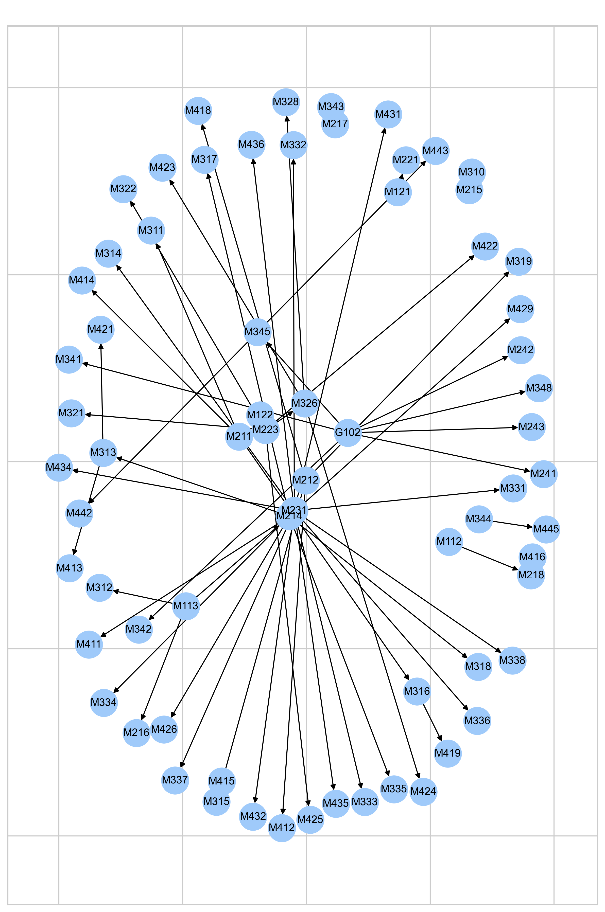
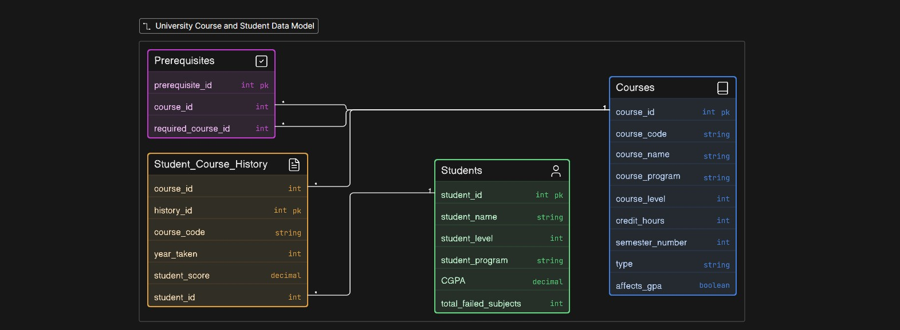

<div align="center">

# 🌸 BloomReady

### An AI-powered academic advisor & course-readiness assistant

*Smart course recommendations from university board rules + a prerequisite graph, followed by syllabus-based study notes and a Bloom's Taxonomy readiness test.*


[Overview](#-overview) • [Features](#-features) • [How It Works](#-how-it-works) • [Quick Start](#-quick-start) • [Project Structure](#-project-structure) • [Author](#-author)

</div>

---
--- 

## 📖 Overview

**BloomReady** helps university students decide **which courses to take next** and **how ready they are** for them.

It is built in three connected parts:

| Part | Name | What it does |
|:---:|------|--------------|
| **I** | EDA & Network Graph Logic | Explores the data, builds the prerequisite graph, and scores every course with the **Curriculum Leverage Score (CLS)** |
| **II** | Board Rules Logic | Encodes the faculty's official regulations (R1–R10) and recommends the best legal course list for each student |
| **III** | BloomReady Module | Reads an uploaded syllabus, generates PDF study notes, and runs a **Bloom's Taxonomy MCQ test** with a readiness score |

> 🎓 Based on the Bachelor's internal regulations of the **Faculty of Science, Mansoura University** (Mathematics & Computer Science programs).

---
<div align="center">
  
</div>
---

## ✨ Features

- 📊 **Full EDA** on 4 relational tables: Students, Courses, Prerequisites, Student Course History
- 🕸️ **Prerequisite graph analysis** with NetworkX: cycle validation, ancestors/descendants, topological order
- 🧮 **Curriculum Leverage Score (CLS)**: an explainable importance score for each course
- ⚖️ **Board rules engine**: semester parity, level progression, prerequisite checks, credit limits, bonus credits, academic warnings, and summer rules
- 🎯 **Greedy course recommender** that picks the highest-CLS eligible courses up to the student's credit limit
- 📄 **Syllabus upload** (`.pdf`, `.docx`, `.pptx`) with automatic text extraction
- 📝 **AI study notes** generated by Gemini and exported as a downloadable PDF
- 🧠 **20-question Bloom's Taxonomy MCQ test** with weighted readiness score and cognitive level

---
<div align="center">
  
</div>

## ⚙️ How It Works

```text
 Students ─┐
 Courses  ─┼─► EDA + Feature Engineering ─► Prerequisite Graph ─► CLS per course
 History  ─┤                                                          │
 Prereqs  ─┘                                                          ▼
                                      Board Rules (R1–R10) ─► Eligible courses
                                                                      │
                                                                      ▼
                                                  Greedy selection by CLS ≤ credit limit
                                                                      │
                                                                      ▼
                          Syllabus upload ─► Gemini ─► PDF notes  /  Bloom's MCQ test
                                                                      │
                                                                      ▼
                                                    Readiness % + Cognitive level
```

### 1️⃣ Curriculum Leverage Score (CLS)

$$
CLS=\left(\frac{D+1}{P+1}\right)_{norm}\times C_{norm}\times G\times R
$$

| Symbol | Meaning |
|:---:|---|
| `D` | Unlock count: number of courses unlocked after passing this one |
| `P` | Prerequisite depth: number of courses required before this one |
| `C_norm` | Min-max normalized credit hours |
| `G` | `1.0` if the course affects GPA, otherwise `0.6` |
| `R` | `1.0` for required courses, `0.8` for electives |

The final CLS is min-max normalized to **[0, 1]** and feeds the recommendation engine.

### 2️⃣ Board Rules Implemented

| Rule | Description |
|:---:|---|
| **R1** | Semester parity check (odd/even) |
| **R2** | Level progression check |
| **R3** | Prerequisites passed check |
| **R4** | Minimum credit hours |
| **R5** | Maximum credits by CGPA |
| **R6** | Bonus course repetition |
| **R7** | Summer semester rules |
| **R8** | Even/odd semester handling |
| **R9** | Outstanding-student bonus credits |
| **R10** | Academic warning / probation status |

A master function, `validate_enrollment`, runs every applicable rule for a student × course pair and returns one consolidated report.

### 3️⃣ Bloom's Taxonomy Readiness

$$
\text{Readiness (\%)}=\frac{\sum(\text{Question Score}\times\text{Level Weight})}{52}\times100
$$

| Cognitive Level Score | Level |
|:---:|---|
| 1.0 – 1.8 | 🟢 Foundational |
| 1.9 – 2.7 | 🟡 Intermediate |
| 2.8 – 3.6 | 🟠 Advanced |
| 3.7 – 5.0 | 🔴 Expert |

---

## 🚀 Quick Start

### 1. Clone the repository

```bash
git clone https://github.com/<your-username>/BloomReady.git
cd BloomReady
```

### 2. Create a virtual environment *(recommended)*

```bash
python -m venv .venv
# Windows
.venv\Scripts\activate
# macOS / Linux
source .venv/bin/activate
```

### 3. Install dependencies

```bash
pip install -r requirements.txt
```

### 4. Add your Gemini API key

Get a free key from [Google AI Studio](https://aistudio.google.com/app/apikey), then set it as an environment variable:

```bash
# Windows (PowerShell)
$env:GEMINI_API_KEY="your_key_here"
# macOS / Linux
export GEMINI_API_KEY="your_key_here"
```

> ⚠️ **Never hard-code your API key or commit it to GitHub.**

### 5. Add the data files

Place the dataset files inside a `Data/` folder:

```text
Data/
├── Courses.csv
├── Students.csv
├── Student_Course_History.xlsx
├── Prerequisites.xlsx
└── ERD.jpg
```

### 6. Run the notebook

```bash
jupyter notebook BloomReady.ipynb
```

---

## 📂 Project Structure

```text
BloomReady/
├── BloomReady.ipynb      # Main notebook (Parts I, II, III)
├── Data/                 # Datasets and ERD diagram
├── requirements.txt      # Python dependencies
├── .gitignore
└── README.md
```

---

## 🛠️ Tech Stack

| Area | Tools |
|---|---|
| Data | `pandas`, `numpy`, `openpyxl` |
| Visualization | `matplotlib`, `seaborn` |
| Graph theory | `networkx` |
| LLM | Google Gemini 2.5 Flash via [`google-genai`](https://ai.google.dev/gemini-api/docs) |
| File parsing | `pdfplumber`, `python-pptx`, `python-docx` |
| PDF export | `fpdf2` |
| UI | `streamlit` |

---

## 🗺️ Roadmap

- [ ] Move the notebook logic into a standalone Streamlit app
- [ ] Add a student dashboard with GPA tracking
- [ ] Support more faculties and programs
- [ ] Add Arabic syllabus support
- [ ] Add unit tests for the board-rule functions

--- 


## 👤 Author

**Mariam M. Rabi**

[](https://github.com/Mariam-mmr)
[](https://www.linkedin.com/in/mariam-mmr/)
[](mailto:mariammrabi@gmail.com)

<div align="center">

⭐ If you find this project useful, please give it a star!

</div>
